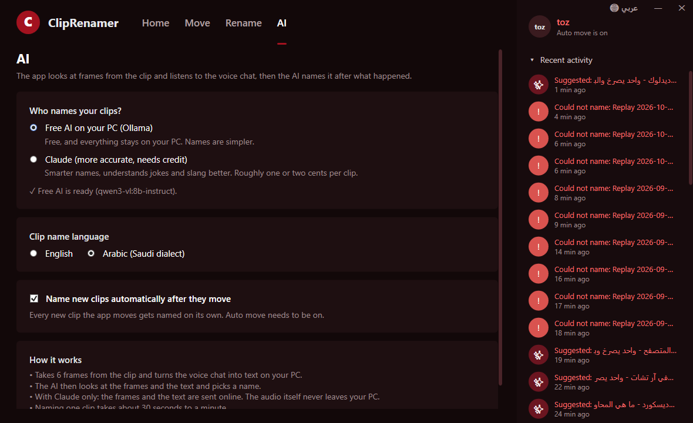

# ClipRenamer

**An idea and project by toz**

> ⚠️ **Early version (beta).** The idea works, but it's still at an early stage.
> AI naming **works well if you have a Claude API key**.
> The free on-device AI gets the game right, but its descriptions of what happened in the clip are **not the best yet**.

A Windows app that organizes your OBS clips for you:

- **Moves clips automatically** from your OBS folder to any folder you choose, such as iCloud Drive, so they upload to the cloud.
- **Names clips with AI** based on what happened in them. It looks at frames from the clip and listens to the voice chat, so `Replay 2026-09-07 14-57-40.mp4` becomes something like `Mimic Party - Zoro Open Na Door impression - 2026-09-07 14-57-40.mp4`.
- **Keeps named and unnamed clips apart:** named clips go to their own folder.
- **Play and delete buttons** next to every clip.

## Features

| | |
|---|---|
| 🔁 Auto move | Runs at logon and every 10 minutes, even when the app is closed |
| 🛡️ Safe | Never overwrites a file, and never touches a clip OBS is still recording |
| ✨ AI naming | Claude (more accurate, paid) or Ollama (free, runs on your PC) |
| 🎙️ Understands voice chat | Turns speech into text on your PC with whisper |
| 📁 Your folders | Choose where clips come from, where they go, and where named clips go |
| 🗑️ Delete | To the Recycle Bin, or to iCloud's "Recently Deleted" |
| 🌐 Two languages | App in English or Arabic, clip names in English or Arabic |

## Getting started

1. Download the project (**Code** → **Download ZIP**) and unzip it anywhere.
2. Double-click **`ClipRenamer.vbs`**.
3. On the **Move** page, pick your folders, then press the big **Start** button.

### AI naming

- The first time, open the **AI** page and press **Download tools**. This downloads ffmpeg and whisper (about 1.8 GB, one time only).
- Choose who names your clips:
  - **Claude (recommended):** paste an API key from [console.anthropic.com](https://console.anthropic.com/settings/keys). Roughly one or two cents per clip.
  - **Free, on your PC:** install [Ollama](https://ollama.com) and run `ollama pull qwen3-vl:8b-instruct`. Needs a decent graphics card (8 GB VRAM or more).

## Requirements

- Windows 10 or 11
- [OBS Studio](https://obsproject.com/)
- No Python needed: it's written in PowerShell, which comes with Windows.

## Privacy

- Your Claude key is stored **encrypted**, on your PC only.
- Speech is turned into text **on your PC**; the audio itself never leaves it.
- With Claude only: 6 frames from the clip and the speech text are sent to Claude. With Ollama, nothing leaves your PC.

## Languages

- The app comes in **English and Arabic**. Switch any time with the 🌐 button at the top.
- Clip names can be written in **English** or **Arabic (Saudi dialect)**. Choose on the **AI** page.

## License

MIT © toz
